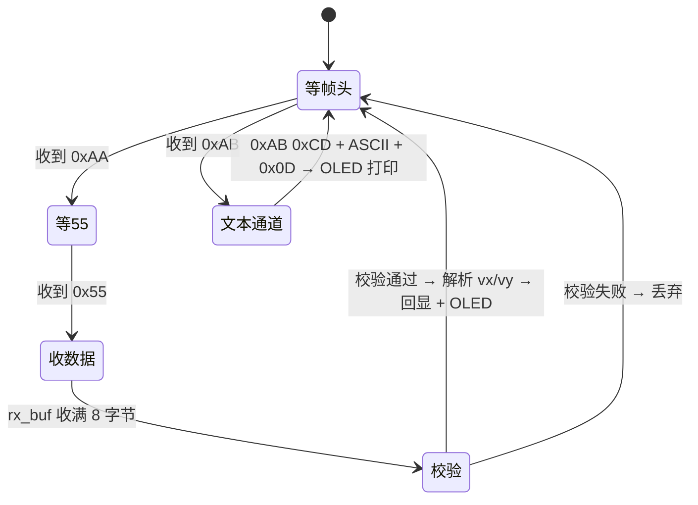

# rostele · STM32F103C6 下位机

接收 ROS2 上位机经 USART1 下发的 `/cmd_vel` 速度指令，解析出 `vx` / `vy`，通过串口回显，并在 SSD1306 OLED 上实时显示；另提供一条独立的调试文本通道。

配套上位机：[upper_computer](../upper_computer/README.md)

---

## 一、硬件与 CubeMX 配置

配置全部记录在 `rostele.ioc`，用 STM32CubeMX 打开即可看到图形化引脚分配。

| 项目 | 值 |
|---|---|
| MCU | STM32F103C6Tx，LQFP48 |
| 固件包 | STM32Cube FW_F1 V1.8.7 |
| 时钟 | HCLK 16 MHz；APB1 8 MHz，APB2 16 MHz |
| USART1 | PA9 = TX，PA10 = RX；异步，115200 / 8N1 —— 接上位机 `/dev/ttyUSB0` |
| USART2 | PA2 = TX，PA3 = RX |
| I2C1 | PB6 = SCL，PB7 = SDA；Fast mode —— 驱动 SSD1306 OLED |
| IDE | Keil MDK-ARM（`MDK-ARM/rostele.uvprojx`） |

上位机发来的运动指令和下位机的 `OK vx:... vy:...` 回显都走 USART1，所以只要一根 USB-TTL 就能联调。

## 二、串口协议与接收状态机

上位机 `serial_bridge.py` 用 `struct.pack('<ff', vx, vy)` 组帧：

| 偏移 | 长度 | 内容 |
|---|---|---|
| 0 | 2 | 帧头 `0xAA 0x55` |
| 2 | 8 | `vx`、`vy`，各 4 字节小端 `float` |
| 10 | 1 | 校验和 `(0xAA + 0x55 + 8 个数据字节) & 0xFF` |
| 11 | 2 | 帧尾 `0x0D 0x0A` |

`Core/Src/main.c` 的 `HAL_UART_RxCpltCallback()` 是**单字节中断 + 状态机**，每收到一个字节只做一次分支判断，然后重新开启中断，不在中断里做浮点解析或刷屏这类耗时操作：

校验通过后用 `memcpy(&g_vx, rx_buf, 4)` / `memcpy(&g_vy, rx_buf+4, 4)` 还原浮点数（两边都是小端 ARM/x86，所以可以直接内存拷贝），再 `sprintf` 回显并调用 `OLED_NewFrame` / `OLED_PrintASCIIString` / `OLED_ShowFrame` 刷新两行显示。帧尾 `0x0D 0x0A` 会在下一轮"等帧头"状态被自然忽略。

## 三、主要文件

| 路径 | 作用 |
|---|---|
| `Core/Src/main.c` | 业务逻辑：串口状态机、vx/vy 解析、OLED 显示、回显 |
| `Core/Src/usart.c` / `Inc/usart.h` | USART1 / USART2 初始化（115200 8N1），`USART1_SendString()` |
| `Core/Src/i2c.c`、`oled.c`、`SSD1306.c` | I2C1 与 SSD1306 屏驱动、ASCII 显示 |
| `Core/Src/font.c` / `Inc/font.h` | 8×6 ASCII 点阵字库（约 56 KB，字模工具生成） |
| `Core/Src/gpio.c`、`stm32f1xx_it.c`、`stm32f1xx_hal_msp.c`、`system_stm32f1xx.c` | CubeMX 生成的外设/中断/系统初始化 |
| `Core/Inc/stm32f1xx_hal_conf.h` | HAL 模块裁剪开关 |
| `rostele.ioc` / `.mxproject` | CubeMX 工程配置与生成记录 |
| `MDK-ARM/rostele.uvprojx` / `.uvoptx` / `rostele.sct` | Keil 工程、选项、链接脚本 |
| `MDK-ARM/startup_stm32f103x6.s` | 启动汇编 |

**CubeMX 工程的关键约定**：自己写的代码必须放在 `/* USER CODE BEGIN ... */` 和 `/* USER CODE END ... */` 之间。重新生成代码时 CubeMX 只保留这些区块，写在区块外的修改会被覆盖。本项目的串口状态机、OLED 调用都在 `USER CODE` 区内。

## 四、编译与恢复

1. 用 Keil MDK-ARM 打开 `MDK-ARM/rostele.uvprojx`，直接 Build；固件输出在 `MDK-ARM/rostele/rostele.hex`。
2. 如果 clone 后没有 `Drivers/`：用 STM32CubeMX 打开 `rostele.ioc`，选择 **FW_F1 V1.8.7**，Generate Code，即可重新生成 CMSIS + HAL 库、`Core/` 初始化代码和 MDK-ARM 工程骨架。
3. 烧录后接 USB-TTL 到 PA9/PA10，上位机启动 `serial_bridge`，OLED 上应显示实时 `vx` / `vy`，串口助手能收到 `OK vx:... vy:...` 回显。

## 五、仓库内容与备份

`Drivers/`（CMSIS + HAL，约 65 MB，含 `.lib` / `.a` 二进制）由 CubeMX 生成，不入库；Keil 编译产物 `.o/.crf/.axf/.map/.hex`、个人界面布局 `.uvguix.*` 也不入库，均由 `.gitignore` 排除。

完整的原始工程备份（含 `Drivers/`、固件和全部编译产物）保存在云端资料库「ROS2 与 STM32 项目备份 / `rostele_stm32_backup_精简版.zip`」。
