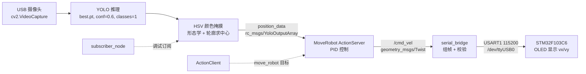

# RC 视觉伺服 · ROS2 上位机工作区

机器人竞赛（RC）视觉伺服系统的**上位机**部分：USB 摄像头采集画面 → YOLO 检测目标 → 自定义 ROS2 消息发布目标中心 → Action 服务端用 PID 算出速度 → 串口下发给 STM32 下位机。

配套下位机工程：[lower_computer](../lower_computer/README.md)

---

## 一、系统是怎么跑起来的



**为什么要拆成 topic / action 两层？**

- **topic（`position_data`）是持续的数据流**：摄像头每 0.1 秒产生一帧检测结果，订阅方随时取最新值即可，不需要应答。
- **action（`move_robot`）是一次带过程的任务**：客户端发一个"开始"目标，服务端执行期间持续回传 feedback（是否运行、目标点、当前速度），最后给 result（success）。启停这种有始有终的行为用 action 比裸 topic 更合适。
- `/cmd_vel` 用标准的 `geometry_msgs/Twist`，这样以后把 PID 换成导航栈、把串口换成底盘驱动，上下游都不用改。

## 二、两个功能包

### `src/rc_msgs` — 接口包（`ament_cmake` + `rosidl_generate_interfaces`）

ROS2 里消息/动作要先编译成各语言的类型，`vision_detect` 才能 `from rc_msgs.msg import ...`，所以接口必须独立成包并**先编译**。

| 文件 | 内容 |
|---|---|
| `msg/YoloOutput.msg` | 单个目标：`float32 center_x` / `center_y` / `confidence` |
| `msg/YoloOutputArray.msg` | `std_msgs/Header header` + `YoloOutput[] yolo_array`（一帧里可能有多个目标） |
| `action/MoveRobot.action` | 目标 `bool start`；结果 `bool success`；反馈 `bool is_running` + `Point goal` + `Twist goal_vel` |
| `msg/yolo_outputmsg.msg`、`yolo_outputarray.msg` | 早期版本的同名接口，保留作历史参考，**未在 CMakeLists 中注册** |

> `CMakeLists.txt` 只把 `YoloOutput.msg` / `YoloOutputArray.msg` / `MoveRobot.action` 交给 `rosidl_generate_interfaces`，另两个小写文件不参与编译——这是有意为之，避免同名消息冲突。

### `src/vision_detect` — 节点包（`ament_python`）

`setup.py` 的 `console_scripts` 注册了 5 个入口：

| 命令 | 源文件 | 作用 |
|---|---|---|
| `yolo_publisher` | `yolo_identify_publisher.py` | 打开摄像头，YOLO 推理后做 HSV 颜色筛选（红/绿/蓝/黄），把目标中心发布到 `position_data` |
| `move_robot_action_server` | `Actionserve.py` | 订阅 `position_data`，以图像中心 `(320, 240)` 为目标做 PID（kp=0.005, ki=0.0002, kd=0.0005），输出 `/cmd_vel` |
| `move_robot_action_client` | `Actioncilent.py` | 向 `move_robot` 发送 `start=True` 目标，并处理 feedback / result |
| `serial_bridge` | `serial_bridge.py` | 订阅 `/cmd_vel`，按协议组帧写到 `/dev/ttyUSB0` |
| `subscriber_node` | `subscribernode.py` | 打印 `position_data`，调试用 |

`test/` 下是 `ament_flake8` / `ament_pep257` / `ament_copyright` 的模板测试。

## 三、串口协议（与下位机约定）

`serial_bridge.py` 用 `struct.pack('<ff', vx, vy)` 组帧：

| 字节 | 内容 |
|---|---|
| 0–1 | 帧头 `0xAA 0x55` |
| 2–9 | `vx`、`vy`，各 4 字节小端 `float` |
| 10 | 校验和：`(0xAA + 0x55 + 8 个数据字节) & 0xFF` |
| 11–12 | 帧尾 `0x0D 0x0A` |

下位机 `main.c` 用 4 状态状态机解析：等 `0xAA` → 等 `0x55` → 收满 8 字节 → 校验和比对 → `memcpy` 还原成 `float g_vx/g_vy`，再回显 `OK vx:... vy:...` 并刷新 OLED。帧尾两个字节会被下一轮状态 0 自然忽略。此外 `0xAB 0xCD ... 0x0D` 是一条独立的调试文本通道，直接把 ASCII 串打到 OLED 上。

## 四、构建与运行

环境：ROS2（Humble / Jazzy）、`python3-opencv`、`ultralytics`、`pyserial`、`geometry_msgs`。

```bash
cd ~/rc_ws
colcon build --packages-select rc_msgs vision_detect   # rc_msgs 必须先于 vision_detect
source install/setup.bash

# 分别在终端里启动
ros2 run vision_detect yolo_publisher
ros2 run vision_detect move_robot_action_server
ros2 run vision_detect move_robot_action_client
ros2 run vision_detect serial_bridge
ros2 run vision_detect subscriber_node        # 可选，调试用
```

**换机器必须改的 3 处硬编码**（这是原工程的实际状态，不是配置化设计）：

1. `yolo_identify_publisher.py` 里的模型路径 `/home/jjh/models/best.pt`；
2. `serial_bridge.py` 里的串口 `/dev/ttyUSB0`（Linux 下常需 `sudo chmod 666 /dev/ttyUSB0` 或把用户加进 `dialout` 组）；
3. HSV 阈值与 PID 参数——现场光照、摄像头分辨率变了都要重新整定（`img_cx/img_cy` 默认按 640×480 写成 320/240）。

## 五、仓库内容与备份

本仓库只保存 `src/` 下的自研源码、接口定义与文档。`build/`、`install/`、`log/` 是 `colcon build` 的产物（可从 `src/` 完全再生），`.venv/`、`.vscode/` 是本地环境缓存，全部由 `.gitignore` 排除。

完整的原始工作区备份（含上述目录、模型与构建日志）保存在云端资料库「ROS2 与 STM32 项目备份 / `rc_ws_backup_精简版.tar.gz`」。
